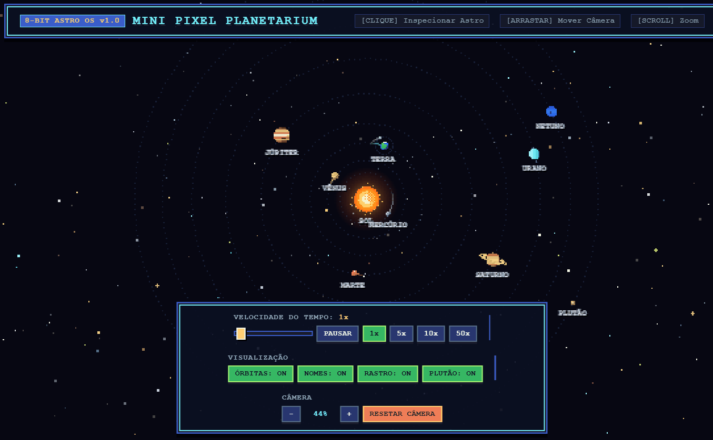

# 🪐 Mini Pixel Planetarium — Sistema Solar Interativo 2D


Um simulador interativo do Sistema Solar estilo **Pixel Art Retrô 8-bit/16-bit** construído 100% com **HTML5 Canvas, CSS3 e JavaScript puro**, sem necessidade de imagens externas ou bibliotecas.

Veja a [demo aqui](https://mulheres-programando.github.io/mini-pixel-planetarium/)!

⭐ Se este projeto te ajudou a aprender algo, deixe uma estrela no repositório!

<p align="center">
  
</p>

> 💡 **Projeto criado pelo grupo [Mulheres Programando](https://mulheresprogramando.substack.com/) para fins educativos!**

---

## ✨ Funcionalidades

- **Pixel Art 100% Procedural (Zero Imagens)**: Todos os astros, texturas, crateras, anéis e efeitos luminosos são desenhados via código em *Canvas Offscreen* com *Integer Scaling* para manter os pixels sempre nítidos.
- **Sol Central & Estrelas Cintilantes**:
  - Fundo do espaço profundo com 260 estrelas piscando em diferentes frequências (incluindo estrelas brilhantes em formato de cruz retrô) e efeito de paralaxe ao mover a câmera.
  - Sol desenhado em pixel art com halo de calor pulsante e partículas solares animadas na coroa.
- **Sistema Solar Completo + Plutão Opcional**:
  - **Planetas Rochosos**: **Mercúrio** (com crateras), **Vênus** (faixas densas de atmosfera), **Terra** (continentes, oceanos, calotas polares e a **Lua** orbitando ao seu redor) e **Marte** (superfície avermelhada e calota polar).
  - **Gigantes Gasosos e de Gelo**: **Júpiter** (faixas atmosféricas e a famosa Grande Mancha Vermelha), **Saturno** (anéis pixelados inclinados desenhados em duas camadas 3D com a Divisão de Cassini), **Urano** (coloração ciano e anel vertical) e **Netuno** (azul profundo com manchas de tempestade).
  - **Planeta Anão**: **Plutão** (com sua famosa planície em formato de coração *Tombaugh Regio*), que pode ser ativado ou ocultado no HUD.
- **Trigonometria & Hierarquia Orbital Realista**: Movimento circular fluido baseado em `Math.cos` e `Math.sin` respeitando a proporção de velocidades reais (Mercúrio orbita muito mais rápido que Netuno) e sistema hierárquico (`Sol → Terra → Lua`).
- **Câmera Interativa & Card Científico**: Pan & Zoom com o mouse, controle de velocidade do tempo (`Pausar`, `1x`, `5x`, `10x`, `50x`) e inspeção por clique que trava a câmera suavemente no astro e exibe distância em UA/km, translação, temperatura média e uma curiosidade científica.

---

## 🎮 Controles e Interatividade

| Controle / Ação | O que faz |
| :--- | :--- |
| **Clique em um Planeta / Sol / Lua** | Move e trava a câmera suavemente no astro e abre o **Card de Dados Científicos** |
| **Arrastar com o Mouse (Pan)** | Explora livremente o espaço (destrava a câmera do planeta atual) |
| **Roda do Mouse (Scroll)** ou **Botões `+` / `-`** | Aumenta ou diminui o Zoom na direção desejada (`28%` a `400%`) |
| **Slider / Botões de Velocidade** | Altera a passagem do tempo entre `Pausar`, `1x`, `5x`, `10x` e `50x` |
| **Botão `ÓRBITAS: ON/OFF`** | Mostra ou oculta as linhas de órbita pontilhadas em pixel art |
| **Botão `NOMES: ON/OFF`** | Mostra ou oculta os rótulos com os nomes dos astros |
| **Botão `RASTRO: ON/OFF`** | Mostra ou oculta a trilha luminosa (*trail*) deixada pelo movimento orbital |
| **Botão `PLUTÃO: ON/OFF`** | Inclui ou remove Plutão da simulação |
| **Botão `RESETAR CÂMERA`** | Volta a câmera para o centro do Sistema Solar (Sol) com zoom padrão (`100%`) |

---

## 🧠 Como Funciona por Dentro

### 1. Game Loop com Delta Time
A simulação roda ~60 vezes por segundo: **calcula o tempo decorrido (`deltaTime`) → atualiza os ângulos orbitais → desenha o espaço → repete**.

```js
function gameLoop(currentTimestamp) {
  const deltaTime = Math.min(0.1, (currentTimestamp - lastTimestamp) / 1000);
  lastTimestamp = currentTimestamp;

  updateOrbits(deltaTime); // atualiza ângulos (seno/cosseno) e câmera
  renderScene();           // desenha estrelas, órbitas, rastros e planetas

  requestAnimationFrame(gameLoop);
}
```

> 📌 Os sprites de todos os planetas nunca mudam de forma, então cada um é desenhado **uma única vez** num canvas em memória (`createPlanetSprite`) na inicialização e apenas copiado a cada frame com `ctx.drawImage()`.

### 2. Pixel Art Nítida
O canvas opera em uma resolução interna reduzida (`PIXEL_SCALE = 2`) e é ampliado via CSS. Para o navegador não aplicar *anti-aliasing* (borrão) nos pixels:

```css
#planetarium { image-rendering: pixelated; }
```
```js
ctx.imageSmoothingEnabled = false;
```

### 3. Trigonometria no Movimento Orbital (`Math.cos` e `Math.sin`)
Para fazer um planeta girar em uma órbita circular de raio `orbitRadius`, convertemos coordenadas polares `(raio, ângulo)` em coordenadas cartesianas `(x, y)`:

```js
// 1. Avança o ângulo (em radianos) proporcional à velocidade do planeta
const angularVelocity = BASE_EARTH_SPEED * body.relativeSpeed;
body.angle += angularVelocity * deltaTime * state.timeSpeed;

// 2. Calcula a posição (X, Y) usando Cosseno (eixo horizontal) e Seno (eixo vertical)
body.x = centerX + Math.cos(body.angle) * body.orbitRadius;
body.y = centerY + Math.sin(body.angle) * body.orbitRadius;
```

### 4. Hierarquia Orbital (`Sol → Terra → Lua`)
Como fazer a Lua orbitar a Terra enquanto a Terra orbita o Sol? Basta definir a posição atual da Terra como o centro da órbita da Lua:

```js
let centerX = 0, centerY = 0; // Por padrão, o centro é o Sol (0, 0)

if (body.parentId) {
  const parent = bodyById[body.parentId]; // Busca a Terra
  centerX = parent.x;
  centerY = parent.y;
}
```

### 5. Câmera Suave (Interpolação Linear / *Lerp*)
Ao clicar em um planeta, a câmera não "teleporta" de forma brusca: ela percorre uma fração da distância restante a cada frame, criando um movimento suave de perseguição espacial:

```js
const smoothing = 1 - Math.pow(0.001, deltaTime);
camera.x += (camera.targetX - camera.x) * smoothing;
camera.y += (camera.targetY - camera.y) * smoothing;
camera.zoom += (camera.targetZoom - camera.zoom) * smoothing;
```

### 🪐 Astros como dados
Os astros não são imagens externas: cada um é um objeto de configuração no array `CELESTIAL_DATA` lido pelo motor de física e pelo gerador procedural de sprites:

```js
{
  id: "earth",
  name: "TERRA",
  radius: 7,
  orbitRadius: 98,
  relativeSpeed: 1.0,
  distanceText: "1,00 UA (149,6 milhões km)",
  periodText: "365,25 dias terrestres",
  tempText: "15 °C",
}
```

Criar um novo planeta ou lua = adicionar um objeto ao array `CELESTIAL_DATA`.

---

## Desafios para Praticar

Quer aprender mexendo no código? Tente, do mais fácil ao mais difícil:

1. 🟢 **Mude as cores de um planeta**: edite o `switch (body.id)` em `createPlanetSprite()` para criar sua própria paleta em pixel art.
2. 🟢 **Crie as luas de Marte (Fobos e Deimos)**: adicione dois novos objetos em `CELESTIAL_DATA` usando `parentId: "mars"`.
3. 🟡 **Luas Galileanas de Júpiter**: adicione *Io, Europa, Ganimedes e Calisto* orbitando Júpiter em velocidades diferentes.
4. 🟡 **Atalhos de teclado**: adicione um `keydown` listener para selecionar os planetas rapidamente apertando as teclas <kbd>1</kbd> a <kbd>9</kbd>.
5. 🔴 **Cinturão de Asteroides**: crie um array com 150 pequenos asteroides de `1x1` ou `2x2` pixels orbitando na faixa entre Marte (`orbitRadius: 132`) e Júpiter (`orbitRadius: 184`).
6. 🔴 **Cometa Halley (Órbita Elíptica)**: crie um cometa usando raios diferentes para o eixo X (`a * Math.cos(angle)`) e para o eixo Y (`b * Math.sin(angle)`), deixando uma cauda de partículas na direção oposta ao Sol!

---

## 🚀 Como Executar Localmente

Como o projeto não possui dependências externas nem etapa de build, basta clonar o repositório e abrir o arquivo `index.html` no navegador:

```bash
# 1. Clone o repositório
git clone https://github.com/SEU-USUARIO/mini-pixel-planetarium.git

# 2. Entre na pasta do projeto
cd mini-pixel-planetarium

# 3. Abra o index.html no navegador
```

---

## 📁 Estrutura de Arquivos

```text
├── index.html       # Estrutura da página, Canvas principal, HUD retrô e Card de inspeção
├── style.css        # Estilização retrô pixelada, molduras 8-bit em CSS puro e responsividade
├── planetarium.js   # Motor 2D em Canvas, sprites procedurais, trigonometria orbital e câmera
├── preview.gif      # Demonstração animada do simulador em funcionamento
└── README.md        # Documentação didática do projeto
```

---

## 🗺️ Roadmap (Próximos Passos)

- [ ] Adicionar Cinturão de Asteroides entre Marte e Júpiter
- [ ] Incluir as principais luas de Júpiter e Saturno (Titã, Encélado, Europa)
- [ ] Efeitos sonoros * synthwave / 8-bit space ambient* opcionais
- [ ] Cometas periódicos cruzando o Sistema Solar em órbitas elípticas

---

## 💜 Gostou do projeto?

🎁 Assine nossa newsletter gratuitamente! Além de receber novidades do mundo da programação, você terá acesso à nossa biblioteca de recursos, com guias rápidos, e-book, e outros materiais.

👉 https://mulheresprogramando.substack.com/subscribe

Após se inscrever, você receberá um e-mail de boas-vindas com o link para a página de recursos.

Nos acompanhe também nas redes sociais:

- [Nosso site](https://mulheresprogramando.com.br/)
- [Página no LinkedIn](https://www.linkedin.com/company/mulheres-programando)
- [Grupo no Facebook](https://www.facebook.com/mulheres.programando/)
- [Instagram](https://www.instagram.com/mulheresprogramando.oficial/)
- [Pinterest](https://br.pinterest.com/mulheresprogramando/)
- [Nossa loja na Amazon](https://www.amazon.com.br/shop/mulherespro0b)

Caso se interesse por **Inteligência Artificial**, acesse também a newsletter [Explorando a IA](https://elisaterumi.substack.com/)!

---

## Star History

<a href="https://www.star-history.com/?repos=mulheres-programando/mini-pixel-planetarium&type=date&legend=top-left">
  <picture>
    <source media="(prefers-color-scheme: dark)" srcset="https://api.star-history.com/chart?repos=mulheres-programando/mini-pixel-planetarium&type=date&theme=dark&legend=top-left" />
    <source media="(prefers-color-scheme: light)" srcset="https://api.star-history.com/chart?repos=mulheres-programando/mini-pixel-planetarium&type=date&legend=top-left" />
    
  </picture>
</a>

---

Feito com ❤️, café e muitos pixels.
